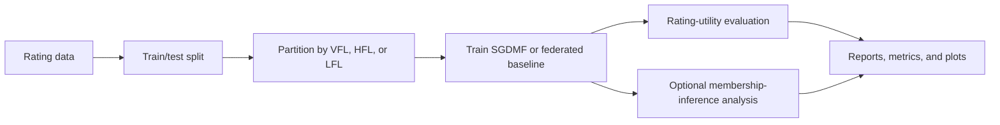

# Federated Matrix Factorization for Recommendation

**A research prototype for studying privacy-aware matrix factorization across vertical, horizontal, and local federated learning settings.**

[](https://www.python.org/)
[](#scope-and-limitations)

This project provides a simulation framework for comparing federated matrix-factorization methods on rating data. It includes implementations for three data-partitioning settings, federated optimization baselines, differential-privacy-related mechanisms, and model-utility and membership-inference evaluation.

> **Important:** This repository is research software, not a production federated-learning or privacy system. Experiments run in a local simulation; enabling noise or setting \(\epsilon\) and \(\delta\) does not by itself establish a formal privacy guarantee. Independently validate the implementation and accounting before drawing privacy conclusions.

## Research context

Matrix factorization models a user–item rating as the dot product of low-dimensional user and item embeddings. In federated recommendation, ratings are divided across parties rather than gathered into a single training table. The choice of partition changes which entities are shared and which remain local:

| Setting | Partition | Prototype interpretation |
| --- | --- | --- |
| **Vertical FL (VFL)** | Items/features across parties | Parties hold different item ratings for a shared user population |
| **Horizontal FL (HFL)** | Users across parties | Parties hold ratings for different subsets of users |
| **Local FL (LFL)** | One user per party | Cross-device-style setting with individual users as parties |

This codebase is intended to support hands-on study of federated matrix factorization, utility/communication trade-offs, and membership-inference analysis across these settings. It is related to the research problem in [*Federated Matrix Factorization with Privacy Guarantee*](https://doi.org/10.14778/3503585.3503598), *Proceedings of the VLDB Endowment*, 15(4), 900–913 (2021). The reference describes the research context; this repository should not be assumed to reproduce the paper's results.

## What is implemented

- **SGDMF variants:** `VFL-SGDMF`, `HFL-SGDMF`, and `LFL-SGDMF`.
- **Federated baselines:** FedAvg, FedProx, and FedADMM.
- **Rating partitioning:** vertical, horizontal, per-user, and balanced/random partitions.
- **Privacy-related mechanisms:** Gaussian-noise and sensitivity helpers, per-user rating trimming, and optional shadow-model membership-inference analysis.
- **Evaluation:** MSE, RMSE, MAE, R², explained variance, training-loss plots, and communication statistics where available.
- **Experiment outputs:** timestamped CSV and pickle summaries, validation reports, and plots.

### Experiment flow



## Repository layout

| File | Description |
| --- | --- |
| [`main.py`](main.py) | Dataset loading, experiment configuration, training/evaluation orchestration, and result export |
| [`data_partitioner.py`](data_partitioner.py) | Rating-data splits for VFL, HFL, and LFL |
| [`party.py`](party.py), [`coordinator.py`](coordinator.py) | Simulated federated parties and coordinator |
| [`sgdmf_vfl.py`](sgdmf_vfl.py), [`sgdmf_hfl.py`](sgdmf_hfl.py), [`sgdmf_lfl.py`](sgdmf_lfl.py) | SGDMF implementations |
| [`fed_avg.py`](fed_avg.py), [`fed_prox.py`](fed_prox.py), [`fed_admm.py`](fed_admm.py) | Federated optimization baselines |
| [`differential_privacy.py`](differential_privacy.py) | Noise, sensitivity, trimming, and privacy-accounting helpers |
| [`matrix_factorization.py`](matrix_factorization.py) | Centralized matrix-factorization implementation |
| [`evaluator.py`](evaluator.py) | Evaluation metrics and visualization |
| [`test_vfl_no_noise.py`](test_vfl_no_noise.py) | Standalone diagnostic comparing VFL training with and without noise |

## Getting started

### Requirements

Python 3.10 or later is recommended. Install the project dependencies in a virtual environment:

```bash
python -m venv .venv
```

Activate the environment, then install:

```bash
python -m pip install numpy pandas matplotlib scipy scikit-learn seaborn
```

Windows activation: `.venv\Scripts\activate`<br>
macOS/Linux activation: `source .venv/bin/activate`

### Run a small synthetic experiment

The following example uses the built-in synthetic dataset and does not require MovieLens files. Save it as `run_synthetic.py` in the repository root, then run `python run_synthetic.py`.

```python
from main import (
    AttackerConfig,
    DatasetManager,
    ExperimentConfig,
    ExperimentRunner,
)

runner = ExperimentRunner(DatasetManager())
result = runner.run_experiment(
    ExperimentConfig(
        experiment_id="synthetic-vfl-smoke",
        algorithm="VFL-SGDMF",
        setting="VFL",
        dataset="synthetic",
        n_parties=2,
        embedding_dim=8,
        T=2,
        T_prime=2,
        learning_rate=0.01,
    ),
    AttackerConfig(run_attacks=False),
)

print(f"Test RMSE: {result['eval_results']['rmse']:.4f}")
```

Experiments write generated files to directories such as `cache/`, `plots/`, `validation_results/`, and `results/`.

### Run the comparative experiment script

```bash
python main.py
```

This runs the comparative configuration at the bottom of `main.py`, not a quick demo. It uses MovieLens 10M, launches multiple worker processes, evaluates several algorithms and party counts, and enables membership-inference analysis. Expect substantial runtime and memory/CPU usage.

## Dataset preparation

The runner expects comma-separated rating files with user, item, and rating columns (for example, `userId,movieId,rating`) at:

```text
data/
├── MovieLens1M/ratings.csv
└── MovieLens10M/ratings.csv
```

Dataset files are not included in this repository. Obtain data from the [GroupLens MovieLens datasets](https://grouplens.org/datasets/movielens/) and follow their terms. The runner reads CSV input; the standard MovieLens 1M distribution uses a different delimiter, so convert it to CSV before use.

**Verify the data path before starting an experiment.** If a configured dataset file is missing, the current loader falls back to synthetic data. `MovieLens25M` has a configuration entry but no included file, and `BookGenome/ratings.csv` is not registered in the experiment runner.

## Reproducibility and interpretation

- Experiment settings are represented by `ExperimentConfig` in `main.py`; the comparative run defines its dataset, algorithm, party-count, and privacy-parameter combinations there.
- The train/test split accepts a random seed. Model initialization and other random operations also use NumPy randomness, so reproducible runs should control and record the full random state and configuration.
- Evaluation in the experiment runner samples up to 100 test ratings. Treat reported metrics as sampled estimates, not automatically as full-test-set evaluations.
- The supplied VFL diagnostic is a standalone script, not a pytest suite. It reads `data/MovieLens1M/ratings.csv` and performs separate training runs with noise disabled and enabled.
- The simulated parties execute within the experiment process; the project does not provide networked clients, secure transport, or deployment infrastructure.

## Scope and limitations

The repository is an experimental implementation intended for exploration and further validation. In particular:

- The privacy mechanisms and accountant should be reviewed against the intended adjacency model, sampling assumptions, clipping, and actual training updates before interpreting any \((\epsilon,\delta)\) values as guarantees.
- Membership-inference results depend on the shadow-model setup, sample selection, and evaluation protocol; they are diagnostic outputs, not a complete privacy audit.
- Reported utility and communication results depend on the selected dataset, partition, random state, and experiment configuration. No benchmark result is claimed here.

## Research opportunities

Potential next steps include validating the privacy accountant against a reference implementation, building a reproducible benchmark protocol, comparing utility across partitioning regimes, and testing stronger threat models for membership inference. Contributions that improve correctness, documentation, and reproducibility are welcome.

For research opportunities or collaboration related to federated learning, privacy-preserving machine learning, and recommender systems, connect with [GreenGOC on GitHub](https://github.com/GreenGOC).

## Citation

If you build on the research context, cite the original article:

> *Federated Matrix Factorization with Privacy Guarantee.* Proceedings of the VLDB Endowment, 15(4), 900–913 (2021). [https://doi.org/10.14778/3503585.3503598](https://doi.org/10.14778/3503585.3503598)
